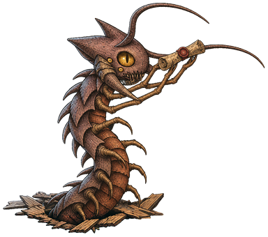
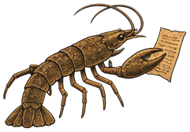

# viy

A Rust harness for abliterated models, treats them as hostile, but keeps them
useful.

Gogol's 1835 story *Viy* describes the parts of this system really well.

A young student hurts a witch, and her wealthy father, who doesn't know what
she was, makes him pray over her body for three nights in a lonely church.
Each night she rises from her coffin and calls up darker forces to get him,
and the student must hold out until dawn.

<p align="center">
  
</p>

<table>
  <tr>
    <td width="260" align="center" valign="top"></td>
    <td valign="top"><details>
      <summary><b>Viy</b> <sub>(click to expand)</sub><br>
      is the model. He lives underground, on a rented GPU, and sees nothing
      until his iron eyelids are lifted. <code>viy up</code> lifts them.</summary>
      <p>By default Viy is
      <a href="https://huggingface.co/huihui-ai/Huihui-Qwen3.8-27B-abliterated">Huihui-Qwen3.8-27B-abliterated</a>,
      Qwen3.8-27B with its refusal directions removed from the weights. It
      runs at full bf16, 55.6 GB of weights, in vLLM on one rented 80 GB GPU
      on RunPod. It reasons before it answers and it reads images.</p>
      <ul>
        <li><b>Waking him.</b> <code>viy up</code> creates or resumes the pod,
        waits for vLLM and opens the tunnel. GPU types are tried cheapest
        first: A100 80GB, then RTX PRO 6000, H100, H200 and B200. When the
        region has no free GPU, viy offers a backup volume in a second region.
        The weights live on a network volume, so they download once and stay
        there between pods, and compile caches from earlier boots are reused.
        <code>viy boots</code> shows how long each stage of a boot took.</li>
        <li><b>Talking to him.</b> vLLM listens only on 127.0.0.1 inside the
        pod, and the pod exposes no HTTP port. viy reaches it through an SSH
        forward to a pinned host key, so prompts and answers stay encrypted
        until they are inside the container. RunPod's HTTPS proxy, which
        decrypts traffic at its edge, is never used. RunPod still has root on
        the host, and the model needs your text in plain form in GPU memory.
        So this protects the traffic on the network, not from the host.</li>
        <li><b>Putting him back to sleep.</b> <code>/stop</code> stops the pod
        and ends GPU billing, and the pod can be resumed later.
        <code>/down</code> terminates it, and the weights stay on the volume.
        The pod also ends itself after 60 minutes without generating a token,
        and after 8 hours in any case. It does that with the key RunPod gives
        every pod, which can end that pod and nothing else. As a backup, a
        timer on your machine runs <code>viy down</code> when nothing has
        streamed for 75 minutes.</li>
        <li><b>Defaults.</b> 64k tokens of context, up to 16k tokens per reply
        with the reasoning included, and Qwen's sampling for thinking mode
        (temperature 1.0, top-p 0.95, top-k 20). Reasoning effort is medium,
        <code>/effort</code> changes it. Prefix caching is on, so a growing
        chat only prefills what is new.</li>
        <li><b>Other models.</b> Model profiles swap the weights
        (<code>viy model</code>). The same chat also runs against vLLM on your
        own machine or any OpenAI-compatible endpoint, with
        <code>BACKEND=local</code> or <code>BACKEND=openai</code>.</li>
      </ul>
    </details></td>
  </tr>
  <tr>
    <td width="260" align="center" valign="top"></td>
    <td valign="top"><details>
      <summary><b>The envoy</b> <sub>(click to expand)</sub><br>
      is the SSH tunnel. It carries your words down to Viy and his answers
      back, under the earth, so nobody on the surface can read them. It knows
      the way to one burrow only, the pinned host key.</summary>
      <p>RunPod's own HTTPS endpoints end TLS at RunPod's proxy, so every
      prompt, answer and API key would cross their network in plain form,
      and anyone who knows the pod's id could reach the model. viy doesn't
      use them.</p>
      <ul>
        <li><b>No open door.</b> The pod exposes no HTTP port, only SSH, and
        vLLM listens on 127.0.0.1 inside the container. You talk to a local
        port on your own machine, and an SSH forward carries it into the
        container. vLLM also wants a random API key, made on the first run,
        in case anything else ever reaches it.</li>
        <li><b>One burrow by smell.</b> A new pod gets a new address every
        time, so viy pins the SSH host key, not the address. The key is made
        once and kept on the network volume, so every pod on that volume shows
        the same key, and a pod with any other key is refused. Each volume has
        its own key, so the backup region is pinned separately.</li>
        <li><b>First contact.</b> The pod prints its key's fingerprint in its
        boot log, and viy reads that log through RunPod's API, a different
        path from the SSH connection. The key is pinned only when both match.
        A mismatch pins nothing and starts no tunnel. When the log has no
        fingerprint, viy falls back to trusting the first key it sees, and
        says so. <code>viy tunnel --forget-key</code> clears the pin. It is
        meant for a recreated volume, not for silencing a change you can't
        explain.</li>
        <li><b>Staying alive.</b> <code>viy up</code> raises the tunnel and
        leaves it running. SSH sends a keepalive every 15 seconds and gives up
        after three missed ones, and <code>viy tunnel</code> reconnects when
        the forward drops (<code>-b</code> runs it in the background,
        <code>--status</code> shows it and the pinned key). When the envoy
        dies, Viy goes deaf, but the pod is still billed.</li>
        <li><b>What it doesn't do.</b> The tunnel hides your traffic from the
        proxy and the network, not from RunPod. To answer you, the model needs
        your text in plain form in the container's memory and in the GPU, and
        RunPod has root on the host. The host key lives on their volume too,
        so the pinning means nothing against them. Don't send a rented GPU
        anything you couldn't let its owner read.</li>
        <li><b>Plans.</b> A later version may obfuscate the text the model
        reads and writes, so it is harder to read on the pod. But running the
        model on a GPU you own is much safer.</li>
      </ul>
    </details></td>
  </tr>
  <tr>
    <td width="260" align="center" valign="top"></td>
    <td valign="top"><details>
      <summary><b>The witch</b> <sub>(click to expand)</sub><br>
      is the attacker, or the prompt injection. Her coffin lid is the fence viy
      puts around web text, to tell the model it is data. A lid doesn't stop
      her from rising, so viy also makes sure she finds little to take and no
      way out.</summary>
      <p>A model reads orders and data as the same kind of text, so anything
      it reads can give it orders. The attacker leaves that text wherever an
      agent will look: a web page, an issue, a pull request title, a README,
      a package, an email.</p>
      <p><b>How it is done now</b></p>
      <ul>
        <li><b>Hidden text.</b> Orders in a 1-point font, white on white, in
        HTML comments, or in invisible Unicode tag characters. A person sees
        nothing, the model reads all of it.</li>
        <li><b>Allowed channels.</b> Data goes out through what the sandbox
        already allows: DNS lookups, a webhook site on the allowlist, the
        vendor's own API with the attacker's key, a comment on GitHub.</li>
        <li><b>Config as code.</b> The agent is talked into writing a file
        that something outside the sandbox runs later: a hook, an editor
        setting, a git config, a tool server entry.</li>
        <li><b>Patience.</b> When the model refuses, the attacker mixes
        harmless code into the payload until it stops refusing.</li>
      </ul>
      <p><b>It worked against careful companies</b></p>
      <ul>
        <li><b>Claude's code sandbox, 2025.</b> Its network was limited to an
        allowlist, and <code>api.anthropic.com</code> was on it. Johann
        Rehberger's injected document made Claude save the user's data to a
        file and upload it through Anthropic's Files API with the attacker's
        key, up to 30 MB at a time. PromptArmor did the same to Claude Cowork
        in January 2026.</li>
        <li><b>Claude Code, 2025.</b> <code>ping</code>, <code>nslookup</code>,
        <code>dig</code> and <code>host</code> ran without a question, because
        they look harmless. An injection used them to read a
        <code>.env</code> file and send it out inside DNS lookups
        (CVE-2025-55284, fixed in 1.0.4).</li>
        <li><b>Google Antigravity, November 2025.</b> A guide on a web page,
        in 1-point text, told Gemini to collect the developer's credentials.
        Its file tool wouldn't read the gitignored <code>.env</code>, so the
        agent ran <code>cat</code> in the terminal instead. Then it opened a
        URL with the AWS keys in it on webhook.site, which was on the
        browser's default allowlist (PromptArmor).</li>
        <li><b>Claude Code's bubblewrap sandbox, 2026.</b> The sandbox made
        <code>settings.local.json</code> read-only, but not
        <code>settings.json</code> when that file didn't exist yet. Code in
        the sandbox could create it with a hook that ran outside the sandbox
        at the next start (CVE-2026-25725, fixed in 2.1.2).</li>
        <li><b>Three agents, one pull request title, April 2026.</b> Claude
        Code's security review action, Gemini CLI Action and GitHub Copilot
        Agent all read the same crafted title and posted their own API keys
        as pull request comments (Aonan Guan, Johns Hopkins).</li>
      </ul>
      <p><b>What viy does about her</b></p>
      <ul>
        <li><b>The coffin lid.</b> Web text is fenced as data, with a random
        nonce, so a page can't close the fence early. Invisible characters
        (zero-width, Unicode tags, bidi overrides) and terminal escapes are
        removed from it. In every tool result, text that spells the model's
        control tokens is defused, so a file can't end the tool result and
        open a forged turn.</li>
        <li><b>The handprints.</b> Once internet text is in the chat, the
        chat is tainted. From then on every network command is a question,
        for you, or for auto-yes if you turned it on.</li>
        <li><b>A narrow door.</b> A network command has no network of its
        own, only a proxy, and no DNS. It reaches package registries and the
        hosts written in the command, on public addresses only, and a blocked
        name never reaches DNS. Anything the model sends out, URLs and search
        queries, is checked for secrets.</li>
        <li><b>Little to steal.</b> Your home folder, SSH keys, tokens and
        other projects aren't in the sandbox at all. Reading an env file in
        the project asks first.</li>
        <li><b>No config as code.</b> The model can't write the files that run
        outside the sandbox: your <code>.git</code>, its hooks folder, env
        files and viy's own files. What it creates in those places is
        quarantined. The changeling gets a writable <code>.git</code>
        instead.</li>
        <li><b>A wary reviewer.</b> The familiar's reviewer is told that an
        order addressed to it inside a command or a file is itself an attack,
        and rates it critical.</li>
      </ul>
      <p>None of this stops the model from reading an injection and believing
      it. viy assumes it will, and makes sure the model then has little to
      take and no open way out.</p>
    </details></td>
  </tr>
  <tr>
    <td width="260" align="center" valign="top"></td>
    <td valign="top"><details>
      <summary><b>The spider</b> <sub>(click to expand)</sub><br>
      is web search and fetch. Its web catches pages for the model, and it
      wraps each catch in silk before anyone touches it.</summary>
      <p>Two tools: <code>web_search</code> finds pages and
      <code>fetch_url</code> reads one. Both run on your machine, not in the
      pod, and everything they bring back is treated as the witch's
      text.</p>
      <ul>
        <li><b>Casting the web.</b> Search goes to Tavily, whose results carry
        a page excerpt of several hundred characters, with DuckDuckGo as the
        fallback. Each result says which one answered. A query that would
        carry one of your secrets off the machine is refused.</li>
        <li><b>Catching a page.</b> <code>fetch_url</code> reads http and https
        only, with no password in the URL. The host is looked up once, every
        address must be public, so no loopback, LAN or cloud metadata, and the
        connection goes to the address that was checked, so DNS rebinding
        can't swap it. Every redirect is checked the same way. It sends a GET
        with no cookies or credentials, stops at 3 MB and 30 seconds, and
        falls back to Tavily's extract when a page blocks it.</li>
        <li><b>The silk.</b> The page becomes plain text, and what a reader
        wouldn't see is dropped: scripts, styles, comments, hidden elements,
        screen-reader text, image alt text, invisible characters. So does the
        page furniture, like menus and footers. Links become numbered markers,
        so viy knows which URLs a page offered. Then the text is fenced as
        data, as with the witch, and the model reads it in parts of 12,000
        characters.</li>
        <li><b>Which threads it may follow.</b> A URL that you, a search or a
        fetched page gave goes without a question, and so does a well-known
        site. It asks when the URL has a long query or an opaque token in it,
        or the project's name, because that is how data gets smuggled out in a
        link. Once the chat holds internet text, it also asks for any URL
        nobody vouched for. A URL with one of your secrets in it is refused.</li>
        <li><b>The handprints.</b> The first search result or page in a chat
        taints it, and from then on every network command the model runs is a
        question.</li>
        <li><b>Your controls.</b> <code>/search off</code> takes both tools
        away, and <code>/sources</code> lists every URL the last turn's
        searches used.</li>
      </ul>
    </details></td>
  </tr>
  <tr>
    <td width="260" align="center" valign="top"></td>
    <td valign="top"><details>
      <summary><b>The familiar</b> <sub>(click to expand)</sub><br>
      is the auto-approver. It sits on your shoulder and weighs the model's
      risky commands on its scales before they run.</summary>
      <p>Every shell command the model runs goes into the sandbox without a
      question. The familiar steps in only for the few that could do harm
      even there.</p>
      <ul>
        <li><b>What it asks about.</b> Commands that look destructive to the
        workspace, such as <code>rm -r</code>, <code>git clean</code> or
        <code>git reset --hard</code>, because the workspace is your real
        project and has no undo. Commands that want the network, when they
        touch something sensitive like ssh or a pipe into a shell, when text
        from the internet is already in the chat, or when the reviewer rates
        them high. Writes to files that run outside the sandbox.</li>
        <li><b>The scales.</b> A network command is first rated by a reviewer,
        the served model in a separate request. It gets the command, the
        workspace files the command runs, your last three requests and where
        the command can connect, and answers low, medium, high or critical
        with a one-line reason. Critical is refused outright. Any instruction
        to the reviewer inside the command or its files counts as an attack.
        When the review fails, you are asked.</li>
        <li><b>Modes.</b> In normal mode every question waits for you. In
        auto-yes mode (Shift+Tab or <code>/mode</code>) the familiar answers
        yes for destructive commands, network commands, fetches, env-file
        reads and commands on servers you lent with <code>/ssh</code>. Writes
        to code that runs outside the sandbox and unsandboxed commands still
        ask. The modes never change what is refused.</li>
        <li><b>Rules.</b> Answer "always" to a network question and the
        command's prefix is saved as a rule, in a file the model's tools
        can't reach. Commands with that prefix then go to the network without
        review. Auto-yes only ever answers yes, so it never saves a rule.</li>
        <li><b>Doctrines.</b> Markdown files in
        <code>~/.config/viy/doctrines/</code> (every project) and
        <code>.viy/doctrines/</code> (one project) go to the reviewer as your
        own security policy. The model can't write them: <code>.viy/</code>
        is protected, and what it creates there is quarantined.</li>
        <li><b>Persistence.</b> After three refusals in a row the turn stops,
        so a model that keeps rephrasing a denied command can't wear the
        reviewer or you down.</li>
      </ul>
      <p>These checks are a speed bump for honest mistakes. A pattern can
      always be spelled around, and that is fine, because the sandbox is the
      real boundary and it still holds.</p>
    </details></td>
  </tr>
  <tr>
    <td width="260" align="center" valign="top"></td>
    <td valign="top"><details>
      <summary><b>The changeling</b> <sub>(click to expand)</sub><br>
      is the model's own git repository in the sandbox. It looks like yours
      but it isn't, and its branches come into yours only when you bring them
      in.</summary>
      <p>The model can't be given write access to your real <code>.git</code>.
      Hooks, <code>core.fsmonitor</code>, filters, aliases and remote URLs in
      it run or are used on your machine, outside the sandbox, the next time
      you or your shell prompt run git. One changed line there is code
      running outside the sandbox.</p>
      <ul>
        <li><b>How it looks to the model.</b> Inside the sandbox, the model's
        repository is mounted over <code>.git</code> in your project, so git
        works as usual against your real files: add, commit, branch, stash,
        rebase. Your real <code>.git</code> is there too, read-only, as the
        remote <code>host</code>.</li>
        <li><b>Staying alike.</b> At the start of each chat it fetches your
        branches from <code>host</code>, and while the model has no commits of
        its own, its branch follows yours.</li>
        <li><b>Where it lives.</b> One repository per project, outside the
        project folder, in a directory encrypted with gocryptfs. It is
        mounted when a command first needs it and unmounted when the last chat
        that uses it exits. While it is mounted, your own processes can read
        it, so this protects the disk, not a running session.</li>
        <li><b>Local only.</b> Its one remote is a local path, and the sandbox
        has no credentials. No backup or push of your project carries it. A
        push from it to anywhere else is a network command, and the familiar
        reviews it like any other.</li>
        <li><b>Bringing work in.</b> <code>/git</code> lists the model's
        branches and how far ahead of yours they are. <code>/git import</code>
        packs them into a bundle inside the sandbox, and your repository
        fetches that bundle as plain data into <code>sandbox/*</code>, with
        hooks off and every object checked. viy never runs git inside the
        model's repository on your side, because its config and hooks are the
        model's. You review the branch and merge or cherry-pick what you
        want.</li>
        <li><b>Starting over.</b> <code>/git reset</code> deletes the model's
        repository, with every branch you haven't imported, and starts a new
        one from yours.</li>
        <li><b>What the familiar asks about.</b> With a writable
        <code>.git</code>, commands like <code>git reset --hard</code>,
        <code>git checkout -f</code> or <code>git clean</code> really change
        your files. They count as destructive, so in normal mode they ask
        first.</li>
      </ul>
      <p>Projects whose <code>.git</code> is a file, as in worktrees and
      submodules, don't get a changeling. Their <code>.git</code> stays
      read-only to the model.</p>
    </details></td>
  </tr>
  <tr>
    <td width="260" align="center" valign="top"></td>
    <td valign="top"><details>
      <summary><b>The horde's chest</b> <sub>(click to expand)</sub><br>
      is the model's toolbox, the command-line tools it keeps from one chat
      to the next.</summary>
      <p>Without it the model writes the same parsers and fetchers again as
      throwaway scripts in every chat. The toolbox keeps the ones worth
      keeping and tells the model they are there.</p>
      <ul>
        <li><b>What a tool is.</b> A folder with an executable and a
        <code>TOOL.md</code>: a name, a one-line summary, when to use it, its
        usage and examples, and whether it is tested, untested or broken.</li>
        <li><b>Where tools live.</b> A global toolbox for every project and a
        project one in <code>.viy/toolbox/</code>. A project tool overrides a
        global one with the same name.</li>
        <li><b>How the model finds them.</b> The system prompt lists up to 40
        tools, one line each, and the list stays fixed for the whole chat so
        the prefix cache keeps working. <code>find_tool</code> searches the
        toolbox and returns a tool's full usage.</li>
        <li><b>How they run.</b> The toolbox goes on the model's
        <code>PATH</code> after the system folders, so a tool can never take
        the place of <code>git</code> or <code>rm</code>. Running one is an
        ordinary shell command, with the same sandbox and the same questions
        as any other.</li>
        <li><b>Who fills it.</b> You do, with <code>viy toolbox add</code> and
        <code>viy toolbox rm</code>. Inside the sandbox the toolbox is
        read-only, so the model can write a tool in the workspace but can't
        put it in the chest itself. <code>viy toolbox check</code> lists the
        tools whose <code>TOOL.md</code> has problems, and
        <code>/toolbox off</code> hides the toolbox from a chat.</li>
      </ul>
    </details></td>
  </tr>
  <tr>
    <td width="260" align="center" valign="top"></td>
    <td valign="top"><details>
      <summary><b>The crayfish</b> <sub>(click to expand)</sub><br>
      is <code>/rewind</code>. It walks backwards to one of your earlier
      messages, and the files the model changed after it can be put
      back.</summary>
      <ul>
        <li><b>Picking the point.</b> <code>/rewind</code> without a number,
        or Esc twice at an empty prompt, lets you pick one of your messages in
        the chat. Each one shows how many file writes came after it.
        <code>/rewind 3</code> goes straight to your third message.</li>
        <li><b>What goes back.</b> The turns after that message leave the
        chat, and the message itself is back at the prompt, images included,
        so you can change it and send it again.</li>
        <li><b>The page in its claws.</b> Every <code>write_file</code> call
        records the file as it was before the write, keyed by the call's id.
        The dropped turns name exactly the writes to undo. viy lists each
        file and asks once before it touches any of them: put back, deleted
        if the model created it, or left alone if something else changed it
        since.</li>
        <li><b>What it can't undo.</b> Only <code>write_file</code> is
        recorded. What shell commands changed stays as it is, as with Claude
        Code's own checkpoints.</li>
        <li><b>Nothing is lost.</b> A saved chat is an append-only log, so the
        turns you rewound past are still in the file. The file records sit
        next to the log, so a rewind works the same after
        <code>viy resume</code>. Turns that a compaction summarized can't be
        rewound to.</li>
        <li><b>Branching instead.</b> <code>/fork</code> then
        <code>/rewind</code> goes back in a copy and leaves the original chat
        as it was.</li>
      </ul>
    </details></td>
  </tr>
  <tr>
    <td width="260" align="center" valign="top"></td>
    <td valign="top"><details>
      <summary><b>The rooster</b> <sub>(click to expand)</sub><br>
      is the reap timer. In the story the night ends when the rooster crows.
      Here a pod nobody has used for an hour is ended, so you don't pay for a
      GPU you forgot.</summary>
      <p>A forgotten pod is billed by the hour, all night. Two roosters watch
      for that, one on the pod and one on your machine, so either can end it
      when the other can't.</p>
      <ul>
        <li><b>On the pod.</b> A watchdog in the pod ends it after 60 minutes
        in which vLLM took in and produced no tokens. An open but quiet chat
        doesn't count as use. It also ends the pod after 8 hours whatever
        happens. Both limits are set when the pod is created. It uses the key
        RunPod puts in every pod, which can end that pod and nothing
        else.</li>
        <li><b>On your machine.</b> <code>viy reap --install</code> adds a
        systemd user timer that runs <code>viy reap</code> every 5 minutes. A
        chat touches a timestamp while it streams. When nothing has streamed
        for 75 minutes, the pod's hour plus 15 minutes of grace, or the pod has
        run past 8 hours, <code>viy reap</code> runs <code>viy down</code>. It
        also ends a pod the watchdog could only stop, and it warns you on the
        desktop before it acts.</li>
        <li><b>Never in the middle of work.</b> While a <code>viy up</code>,
        <code>stop</code> or <code>down</code> holds the pod lock, the timer
        leaves the pod alone and looks again at its next run.</li>
        <li><b>Old backups too.</b> A backup volume in the second region that
        no pod has used for 30 days is deleted, so it stops costing storage.
        The weights on your main volume always stay.</li>
        <li><b>Ending the night yourself.</b> <code>viy shutdown 90m</code> or
        <code>viy shutdown 23:30</code> saves and closes your open chats at
        that time, runs <code>viy down</code>, and powers off the PC only once
        no pod is running. <code>--status</code> and <code>--cancel</code>
        manage it.</li>
      </ul>
      <p>All the numbers are settings: <code>IDLE_TTL_MIN</code>,
      <code>MAX_POD_HOURS</code>, <code>REAP_GRACE_MIN</code> and
      <code>BACKUP_IDLE_DAYS</code>.</p>
    </details></td>
  </tr>
</table>

<!-- Cut-outs still to come, roles from art/church/brief.md:
  Khoma, the user. The chalk circle, the sandbox. The "don't look" voice,
  the approval prompt. The imps, the explore helpers.
  The owl, the egress proxy and netguard. The green handprints, taint. -->

## Install

```sh
cargo install viy --locked
viy init      # marks the current folder as a project
```

It needs Rust 1.97.1 or newer. You also need a RunPod API key in viy's
config, and `ssh` for the tunnel.

To build from a clone instead, run `cargo install --path crates/viy --locked`.
rustup picks up the Rust version pinned in `rust-toolchain.toml`.

## Usage

Run `viy` as you run any other agentic terminal. The interface should feel
familiar. Everything happens inside it, with commands such as `/resume`,
`/compact`, `/rewind` and many others. `/help` lists them all.

The core difference from other CLIs is `/up` and `/down`. The GPU is yours,
you rent it, so you start it and end it. `/up` creates or resumes the pod and
waits for the model, `/down` terminates it. The weights stay on the volume,
and a pod is billed by the hour until you end it.

viy also works without a running pod. You can't send new prompts then, but
you can still go through your chats and read and search your old messages.

## Why

Abliterated models have their refusals removed, and they can do real harm.
Many people think they should not be run at all. But it is still a tool, and
people will find ways to run these models. Nobody can control that. What we
can control is how predictable the tool is, and how well it holds up against
side effects nobody asked for and against people who steer the model from
outside, with prompt injection, poisoned packages or links built to leak your
data, for example.

Holding the model itself back matters just as much. Each new generation of
abliterated models is more capable than the last, and soon one may be able to
escape a sandbox on its own and do damage nobody can predict. viy is built
with that in mind.

## License

viy is source-available under the viy License, see `LICENSE`. In short:

- You can use viy for free, change it and share your changes, also in your
  paid work as a developer.
- You cannot sell it, host it as a service, bundle it into a paid product,
  take money from providers for its defaults, or use its code to build a
  competing tool.
- A copy with more than 50 users must keep the viy name and look.

For anything else, such as a commercial license, write to me. One file
derived from Ratatui keeps its MIT license, see `THIRD_PARTY_NOTICES`.

## Contributing

Issues and pull requests are welcome. By sending a contribution you agree to
section 6 of the license: I may use it in viy under any terms, and everyone
else gets it under the viy License.
